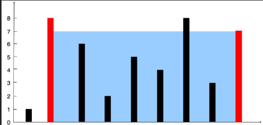

# 11. Container With Most Water

## Problem Statement

You are given an integer array `height` of length `n`. There are `n` vertical lines drawn such that the two endpoints of the `i`-th line are `(i, 0)` and `(i, height[i])`.

Find two lines that together with the x-axis form a container, such that the container contains the most water.

**Return the maximum area of water the container can store.**

### Important Notes:
- You may not slant the container
- The container's width is determined by the distance between two lines
- The container's height is limited by the shorter line

### Examples:

**Input:** height = [1,8,6,2,5,4,8,3,7]  
**Output:** 49  
**Explanation:** The vertical lines at index 1 (height 8) and index 8 (height 7)
form a container with area = min(8,7) * (8-1) = 7 * 7 = 49 


**Input:** height = [1,1]  
**Output:** 1
**Explanation:** The maximum area is 1


**Input:** height = [4,3,2,1,4]  
**Output:** 16  
**Explanation:** The vertical lines at index 0 (height 4) and index 4 (height 4)
form a container with area = min(4,4) * (4-0) = 4 * 4 = 16

##  Understanding the Problem

### The Formula

 ### Area = min(height[left], height[right]) × (right - left)

 ---



### The container between index 1 and 8:

Left height: 8  
Right height: 7  
Height limit: min(8, 7) = 7  
Width: 8 - 1 = 7  
Area: 7 × 7 = 49  


---

##  Solution: Two Pointers Approach

### Algorithm

The key insight: **Start with the maximum width and optimize by moving the shorter line inward.**

1. **Initialize:** Two pointers at the extremes (left = 0, right = n-1)
2. **Calculate:** Area with current pointers
3. **Track:** Maximum area found
4. **Move:** The pointer with the **shorter height** inward
   - Why? Moving the taller line won't increase area (limited by the shorter one anyway)
   - Moving the shorter line might find a taller line that increases area

### Code (For LeetCode)

```java
class Solution {
    public int maxArea(int[] height) {
        int left = 0;
        int right = height.length - 1;
        int maxArea = 0;

        while(left < right){
            int width = right - left;
            int currentHeight = Math.min(height[left], height[right]);
            int currentArea = width * currentHeight;

            maxArea = Math.max(maxArea, currentArea);

            if(height[left] < height[right]){
                left++;
            } else {
                right--;
            }
        }
        return maxArea;
    }
}
```

##  Complexity Analysis

**Time Complexity:** O(n)
- Single pass through the array with two pointers
- Each element is visited at most once

**Space Complexity:** O(1)
- Only using a few variables (left, right, maxArea)
- No extra data structures
